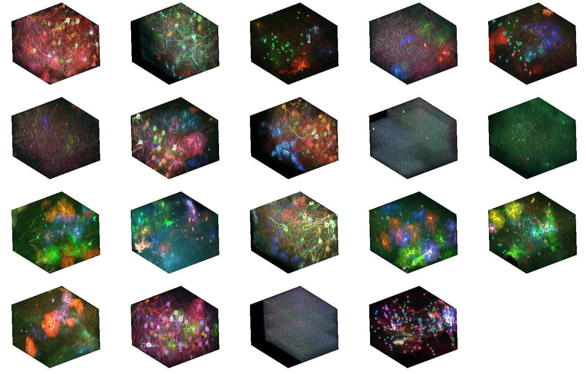

This project is part of the  brainhack-donostia 2026 hackathon. For more information, please visit
https://brainhack-donostia.github.io/

## Brainhack project description


**Brainbow** datasets enable researchers to distinguish individual cells and identify **lineage clusters**, providing valuable insights into brain development and cellular organization. Recent advances in microscopy, such as **ChroMS**, now make it possible to acquire **mesoscale images of entire brains**, opening new opportunities for **large-scale cellular analysis**.

Here we used the publicly available **Brainbow dataset** from the **IDR** (https://idr.openmicroscopy.org/study/idr0048/) to extract **brainbow labeled patches of a mouse cortex**.


## Instructions to download the patches

Download all the patches according to `data/datasets.yaml` to `data/patches.ome.zarr` using the following command:
```bash
uv run python scripts/download_patches.py --config data/datasets.yaml --output-dir data/ --skip-existing
```

It will create a `data/patches.ome.zarr` folder containing all the patches and a `data/manifest.csv` file with the metadata of each patch.

## Instructions to visualize the patches
To visualize the patches in a grid, you can use the following command:
```bash
uv run python scripts/overview_tile.py data/patches.ome.zarr data/annotations --no-translate --no-zarr
```

If you want to visualize the patches in 3D in the original coordinate system, you can use the following command:
```bash
uv run python scripts/overview_tile.py data/patches.ome.zarr/raw data/annotations
```

# Results

## Annotations of the patches

In `data/annotations` you can find the annotations of the patches in the form of one csv file per patch. Each csv file contains the following columns:
- `index`: index of the annotation
- `axis-0`: z coordinate of the centroid (compatible with napari viewer)
- `axis-1`: y
- `axis-2`: x
- `class`: class of the annotation (e.g. cell type)

Cell types are annotated according to the following classes:
- `1`: Astrocyte
- `2`: Pyramidal Neuron
- `3`: unknown



## Statistics of the patches

You can run
```bash
uv run scripts/count_annotations.py data/annotations --manifest data/manifest.csv --csv count_annotations.csv
```

# License
## Data citation
- source: https://idr.openmicroscopy.org/study/idr0048/
- Authors: Multicolor multiscale brain imaging with chromatic multiphoton serial microscopy, Abdeladim L, Matho KS, Clavreul S, Mahou P, Sintes J-M, Solinas X, Arganda-Carreras I, Turney SG, Lichtman JW, Chessel A, Bemelmans A-P, Loulier K, Supatto W, Livet J, Beaurepaire E
- License / access: CC BY-NC 4.0

## This annotations citation

- Source: doi:10.5281/zenodo.24339994
- Authors: Clément Caporal, Michal Ejankowski, Helen Fiorella Medina, Leonidas Ioannidis, Tania Orosco, Ignacio Arganda-Carreras
- License / access: CC BY-NC 4.0

If you find those annotations useful please cite this repository using its DOI as follows:

    brainbow brainhack donostia contributors (2026). napari: a multi-dimensional image viewer for python. doi:10.5281/zenodo.24339994

Note this DOI will resolve to all versions of this repository. If you want to cite a specific version, please use the DOI of that version, which can be found in the Zenodo page of this repository.